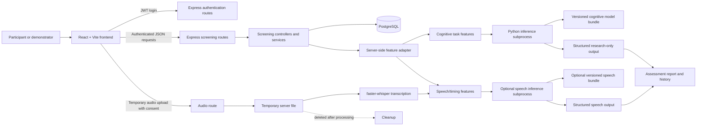

# MindScan AI — Intelligent Cognitive Assessment and Dementia Research Platform

MindScan AI is a full-stack, research-oriented cognitive assessment prototype. It
combines browser-based cognitive tasks, optional consent-driven speech
transcription, deterministic descriptive measurements, guarded research-model
inference, and persisted assessment reports.

The project is suitable for a university demonstration, software engineering
evaluation, and controlled research prototyping. It is **not a medical device,
diagnostic service, validated screening instrument, or substitute for a
qualified clinical assessment**. Task scores, speech observations, model
classes, and the educational simulated percentage are intentionally presented
as separate concepts.

## Table of contents

- [Project overview](#project-overview)
- [Features and scope](#features-and-scope)
- [Technology stack](#technology-stack)
- [System architecture](#system-architecture)
- [Assessment workflow and data flow](#assessment-workflow-and-data-flow)
- [Data and field reference](#data-and-field-reference)
- [Datasets and artifacts](#datasets-and-artifacts)
- [Machine-learning algorithms](#machine-learning-algorithms)
- [Speech analysis](#speech-analysis)
- [Model inference and API contract](#model-inference-and-api-contract)
- [Architecture and design decisions](#architecture-and-design-decisions)
- [Installation and execution](#installation-and-execution)
- [Environment variables](#environment-variables)
- [Testing and evaluation](#testing-and-evaluation)
- [Deployment](#deployment)
- [Limitations and future work](#limitations-and-future-work)
- [References](#references)

## Project overview

### Problem statement

Cognitive screening workflows often need to combine several small observations:
memory recall, attention, orientation, language responses, intake context, and,
where explicitly consented, speech measurements. A research prototype must
preserve the distinction between:

1. what a participant actually did in an application task;
2. what deterministic software measured from that response;
3. what an experimental model classified; and
4. what would require independent clinical validation.

MindScan implements that separation end to end. It stores an authenticated
assessment session, derives an allowlisted feature record on the server, and
optionally invokes a versioned Python model bundle through a bounded subprocess.
If a compatible model is missing, incompatible, unauthorized, or unavailable,
the API returns an explicit unavailable state rather than fabricating a result.

### Objectives

- Provide a resumable, authenticated assessment workflow.
- Collect reproducible memory, attention, orientation, and language task data.
- Keep optional audio processing separate from cognitive-task inference.
- Persist safe assessment measurements and report history in PostgreSQL.
- Support reproducible, participant-grouped research experiments.
- Validate model bundles, schemas, provenance, hashes, labels, and inputs before
  inference.
- Make unavailable, synthetic, and research-only outputs obvious in the UI.

### Use cases

- University project demonstration and viva presentation.
- Local evaluation of frontend, backend, database, and Python integration.
- Research software mechanics using clearly marked synthetic fixtures.
- Development of future authorized MindScan-labelled datasets.
- Audit and reproducibility work on the isolated SATURN experiment.

### Scope boundary

The current application does not claim:

- a clinically validated dementia probability;
- a conversion from MindScan task scores to MMSE, MoCA, CDR, or diagnosis;
- compatibility between SATURN/OASIS-style fields and live MindScan tasks;
- a trained dementia classifier from the local audio directory;
- multimodal fusion of cognitive and speech outputs;
- clinical calibration, prospective validation, fairness validation, or
  deployment readiness.

## Features and scope

### Implemented

| Capability | Implementation status |
| --- | --- |
| Account registration and login | Implemented with bcrypt password hashing and JWT authentication |
| Protected assessment routes | Implemented; assessment reads and writes are scoped to the authenticated account |
| Patient/intake profile | Implemented; age and consent are required, other fields are optional |
| Memory recall task | Implemented; unique correctly recalled words are counted |
| Attention task | Implemented; correct, incorrect, missed, and reaction-time measurements are stored |
| Orientation task | Implemented; server-side scoring uses the supplied local assessment date |
| Language fluency task | Implemented; sentence character count and list-response count are retained |
| Optional motor tapping task | Implemented as an exploratory measurement; not part of the cognitive model contract |
| Optional clinician observation form | Implemented as separately recorded observations |
| Cognitive task-performance score | Implemented as the unweighted mean of measured memory, attention, and orientation percentages |
| Simulated report percentage | Implemented for demonstration only; `100 - cognitive task score`, clamped to 0–100, and clearly labelled as non-clinical |
| Consent-driven audio upload | Implemented with MIME/signature checks, size limits, temporary files, and cleanup |
| Offline faster-whisper transcription | Implemented when the optional audio environment and cached model are available |
| Deterministic speech observations | Implemented from transcript text and valid timing metadata |
| Research-model inference | Implemented through the guarded Python bundle contract when explicitly configured |
| Assessment persistence/history | Implemented in PostgreSQL, including task responses and safe result JSON |
| Frontend report visualization | Implemented; task scores, speech observations, model outputs, and simulated output remain separate |
| Synthetic research bundle | Retained under `artifacts/models/synthetic-research/`; not a clinical model |
| SATURN baseline | Retained under `research-data/saturn_dryad_2025/`; isolated from the live schema |

### Experimental or unavailable

- **Cognitive research inference** is unavailable by default unless a compatible
  versioned bundle is configured with `MINDSCAN_MODEL_DIR` and
  `MINDSCAN_MODEL_VERSION`.
- The retained synthetic bundle can be used for controlled local mechanics
  demonstrations. Its classes are simulated performance groups, not diagnoses.
- **Speech classification** is unavailable unless a separately authorized,
  compatible speech bundle is configured. The current audio path primarily
  transcribes and extracts descriptive measurements.
- `/api/ai/analyze` intentionally returns unavailable because the heuristic
  ensemble is not clinically validated.
- SATURN and the legacy OASIS-style artifacts are not compatible with live
  MindScan inference.
- Multimodal fusion is a design boundary only; there is no fusion endpoint or
  fusion model.

## Technology stack

| Layer | Technology verified in this repository |
| --- | --- |
| Frontend | React `19.2.8`, Vite `8.3.0`, browser Fetch API |
| Frontend quality | ESLint `10.10.0`, Node built-in test runner |
| Backend | Node.js, Express `4.22.3`, ESM modules |
| Authentication | `bcrypt` `6.0.0`, `jsonwebtoken` `9.0.3` |
| HTTP/integration | `axios` `1.20.0`, Express middleware, JSON APIs |
| Database | PostgreSQL via `pg` `8.23.0`; numbered SQL migrations |
| Research ML | Python, pandas `3.0.6`, NumPy `2.5.3`, scikit-learn `1.9.1`, joblib `1.6.0` |
| Cognitive models | scikit-learn `LogisticRegression` and `RandomForestClassifier` |
| Speech transcription | `faster-whisper` `1.2.1`, optional dedicated Python environment |
| Build/development | npm lockfiles, Vite build, nodemon, PowerShell setup script |
| Documented deployment | Render backend, Neon PostgreSQL, Vercel frontend |

The repository also contains `cors` and `dotenv` backend dependencies. Python
versions are checked by `setup.ps1`; the current setup requires Python 3.11 or
newer for the project environment. The installed research metadata records
Python 3.14 for the retained SATURN run.

## System architecture



There is no Python HTTP server. Node invokes `predict.py` through a subprocess
with JSON on stdin, a ten-second cognitive inference timeout, bounded output,
and non-sensitive error handling. The audio transcription subprocess has its
own timeout and temporary-file lifecycle.

## Assessment workflow and data flow

1. The user registers or logs in through `/api/auth`.
2. The frontend starts an assessment with an intake profile and consent.
3. The backend creates an owned screening session and patient profile.
4. Required tasks are completed in the browser:
   memory, attention, orientation, and language.
5. The frontend submits each response to `/api/screening/:id/response`.
6. The backend validates the response, calculates supported task scores, and
   stores the response JSON, score, and reaction-time value.
7. Optional audio is uploaded only after authentication and consent. It is
   validated, written to a private temporary directory, transcribed, analysed,
   and deleted after processing.
8. `/api/screening/:id/result` loads the owned assessment and derives
   allowlisted cognitive and speech feature records on the server.
9. The cognitive and speech model paths are invoked independently. Missing
   models stay unavailable; outputs are never fused or converted into a
   clinical risk value.
10. The result is persisted in `screening_results` and rendered by the report
    page and history view.

### Cognitive task scoring

The stored `cognitiveTaskScore.index_percent` is the arithmetic mean of the
available memory, attention, and orientation task percentages:

```text
index_percent = mean(measured memory %, attention %, orientation %)
```

Language is not included in this composite because the current language task
does not have a validated numeric scoring rule. The score is a task-performance
summary, not a validated cognitive instrument.

The report also contains the educational-only presentation mapping:

```text
simulatedProbability = clamp(100 - cognitiveTaskPerformanceScore, 0, 100)
```

For example, `16.65/100` displays as `83.35%`. This value is visually separate
from model output and includes the disclaimer:

> Illustrative score-to-percentage mapping for an educational demonstration.
> Not a clinically validated probability or diagnosis.

It must not be interpreted as a dementia probability.

## Data and field reference

### Intake fields

| Field | Type | Meaning/source | Storage/model use |
| --- | --- | --- | --- |
| `patientIdentifier` | string, optional | Study identifier supplied by the user | Stored profile context; never a model feature |
| `age` | integer, 1–120 | Required intake age | Stored profile; `age_years` may be a cognitive-model feature |
| `sex` | category, optional | `female`, `male`, `intersex`, `self_described`, or `prefer_not_to_say` | Stored profile; `sex` may be a cognitive-model feature |
| `educationYears` | number, 0–40, optional | Intake education duration | Stored profile; `education_years` may be a cognitive-model feature |
| `handedness` | category, optional | `right`, `left`, `ambidextrous`, or `unknown` | Stored profile; `handedness` may be a cognitive-model feature |
| `socioeconomicStatus` | number, 1–5, optional | Intake context | Stored profile; not in the current model feature schema |
| `medicalHistory` | string, optional | User-entered context | Stored profile; not a model feature |
| `medications` | string, optional | User-entered context | Stored profile; not a model feature |
| `reportedSymptoms` | string, optional | User-entered context | Stored profile; not a model feature |
| `symptomOnset` | string, optional | User-entered context | Stored profile; not a model feature |
| `functionalChanges` | string, optional | User-entered context | Stored profile; not a model feature |
| `familyHistory` | string, optional | User-entered context | Stored profile; not a model feature |
| `consent` | boolean | Required consent for research assessment storage | Stored as `consent_at`; never a model feature |

MMSE, MoCA, CDR, MRI values, diagnosis fields, and patient identifiers are not
collected as live model inputs. The clinician form may display MMSE/CDR fields
for separately recorded observations, but they are not inferred from task
performance and are not in the MindScan model schema.

### Cognitive task inputs and derived values

| Task | Collected inputs | Derived fields | Raw/derived/model role |
| --- | --- | --- | --- |
| Memory recall | `wordsShown`, `wordsRecalled` | Correct unique words, presented count, errors, accuracy ratio | Raw response plus derived cognitive model features |
| Attention | `correct`, `wrong`, `missed`, `reactionTimes` | Error count, accuracy ratio, mean reaction time | Raw response plus derived cognitive model features |
| Orientation | Year, month, date, place, assessment date | Server-scored correct count, scored count, accuracy ratio | Raw response plus derived cognitive model features |
| Language fluency | Sentence response and animal/list response | Sentence character count, list-response count | Raw response plus two optional cognitive model features; no language task score |
| Motor tapping | Hand and event timestamps/offsets | Tapping count/timing measurements | Exploratory persisted observation; not in the cognitive model |
| Clinician observation | Observation statuses, notes, optional clinical measurements | Validated observation record | Separate clinician-entered record; not a model feature |

### Versioned cognitive model schema: 19 features

The authoritative schema is
[`Backend/ml/feature_schema.json`](./Backend/ml/feature_schema.json). The
current cognitive contract contains 15 task-derived fields and 4 intake
fields:

| Feature | Type/unit | Meaning |
| --- | --- | --- |
| `memory_recall_count` | number/words | Unique correctly recalled presented words |
| `memory_presented_count` | number/words | Unique words shown |
| `memory_error_count` | number/words | Presented words minus unique correct recalls |
| `memory_accuracy_ratio` | number/ratio | Correct recalls divided by presented words |
| `attention_correct_count` | number/trials | Correct attention responses |
| `attention_incorrect_count` | number/trials | Incorrect attention responses |
| `attention_missed_count` | number/trials | Missed attention responses |
| `attention_error_count` | number/trials | Incorrect plus missed attention responses |
| `attention_accuracy_ratio` | number/ratio | Correct divided by correct + incorrect + missed |
| `attention_mean_reaction_time_ms` | number/ms | Mean valid browser reaction time |
| `orientation_correct_count` | number/items | Correct server-scored orientation items |
| `orientation_scored_count` | number/items | Orientation items actually scored |
| `orientation_accuracy_ratio` | number/ratio | Correct orientation items divided by scored items |
| `language_sentence_character_count` | number/characters | Trimmed sentence response length |
| `language_list_response_count` | number/items | Parsed list-response item count |
| `age_years` | number/years | Consented intake age |
| `education_years` | number/years | Optional intake education |
| `sex` | category | Optional intake category |
| `handedness` | category | Intake handedness category |

Feature records are created by
[`Backend/services/mlService.js`](./Backend/services/mlService.js), not accepted
from the prediction caller. Missing values remain missing; the model pipeline
handles them only if the selected bundle declares compatible preprocessing.

### Versioned speech feature schema: 14 features

Speech is a separate modality. The live speech contract contains:

| Feature | Type/unit | Source/meaning |
| --- | --- | --- |
| `voice_audio_duration_seconds` | number/seconds | Decoded audio duration |
| `voice_speaking_duration_seconds` | number/seconds | Union of valid transcription segment intervals |
| `voice_transcript_word_count` | number/words | Unicode-tokenized transcript words |
| `voice_transcript_character_count` | number/characters | Trimmed transcript length |
| `voice_speech_rate_words_per_minute` | number/WPM | Word count divided by valid timed speech duration |
| `voice_pause_count` | number/gaps | Positive gaps between valid segments |
| `voice_mean_pause_seconds` | number/seconds | Mean positive segment gap |
| `voice_maximum_pause_seconds` | number/seconds | Largest positive segment gap |
| `voice_estimated_non_speech_ratio` | number/ratio | Duration minus timed speech divided by duration |
| `voice_filler_word_count` | number/tokens | English filler-token count |
| `voice_filler_word_ratio_percent` | number/percent | English filler count divided by word count |
| `voice_adjacent_repeated_word_count` | number/tokens | Case-folded adjacent repeated words |
| `voice_lexical_diversity` | number/ratio | Unique transcript tokens divided by total tokens |
| `voice_mean_sentence_length_words` | number/words | Mean punctuation-delimited sentence length |

Pitch means and standard deviations are explicitly unavailable in the current
transcription path.

### Prediction response fields

Successful research inference has the following shape:

```json
{
  "status": "available_research_only",
  "model_version": "mindscan-synthetic-v1.0.0",
  "model_name": "random_forest",
  "modality": "cognitive_tasks",
  "labels": [
    "synthetic_lower_performance",
    "synthetic_higher_performance"
  ],
  "output": {
    "predicted_label": "synthetic_higher_performance",
    "class_scores": {
      "synthetic_lower_performance": 0.31,
      "synthetic_higher_performance": 0.69
    },
    "scores_are_calibrated_probabilities": false
  },
  "evaluation_status": "held_out_test_evaluated",
  "synthetic_demo": true,
  "clinical_validity": false
}
```

The example is sanitized and illustrative; class scores are model outputs, not
clinical probabilities. Unavailable responses include `status: "unavailable"`,
`code`, `reason`, `missing_inputs`, `model_version`, and `output: null`.
Invalid feature requests return `status: "invalid_input"`. Python inference
also validates bundle format, schema version, metadata version, feature
names/types/ranges/categories, labels, model-file hashes, and provenance.

### Persisted assessment result fields

The PostgreSQL result record contains:

| Field | Type | Meaning |
| --- | --- | --- |
| `screening_id` | integer | Unique owned screening session |
| `memory_score` | numeric | Stored task score |
| `attention_score` | numeric | Stored task score |
| `language_score` | numeric/null | Legacy/result field; current language task has no validated score |
| `orientation_score` | numeric | Stored task score |
| `overall_score` | numeric | Current descriptive cognitive score where available |
| `risk_level`, `risk_score`, `probability` | legacy/result fields | Not populated with fabricated clinical inference |
| `task_scores` | JSONB | Task scores, measurements, safe model status/output, and report metadata |
| `recommendation` | text | Research/report recommendation text |
| `flags` | JSONB | Assessment notes and flags |
| timestamps | timestamp | Creation and session timing |

Raw uploaded audio is not persisted as an assessment response. The current
saved voice payload contains allowlisted observations rather than transcript
text.

## Datasets and artifacts

### Local OASIS-style tabular artifact

`artifacts/models/tabular/baseline_v1/metadata.json` describes a legacy
Logistic Regression artifact trained from a local
`Backend/data/dementia_dataset.csv`-style cohort:

- 373 rows in the recorded train/test metadata: 275 train and 98 test.
- 12 input fields: `Visit`, `MR Delay`, `M/F`, `Hand`, `Age`, `EDUC`, `SES`,
  `MMSE`, `CDR`, `eTIV`, `nWBV`, and `ASF`.
- Target mapping: `Nondemented -> 0`; `Demented` and `Converted -> 1`.
- Recorded metadata metrics: accuracy `0.9388`, weighted F1 `0.9379`, binary F1
  `0.9118`, and ROC-AUC `0.9691` on its recorded test partition.

This artifact is **not compatible** with the current MindScan task schema. It
requires MMSE/CDR and MRI-derived fields that the live app does not collect,
and its dataset provenance and use authorization are not established in this
repository. The backend therefore reports an explicit legacy-unavailable
explanation instead of renaming or fabricating fields.

### SATURN Dryad research baseline

The isolated SATURN experiment is stored under
[`research-data/saturn_dryad_2025/`](./research-data/saturn_dryad_2025/).
Its source is the Dryad release identified by DOI
[`10.5061/dryad.j9kd51cq4`](https://doi.org/10.5061/dryad.j9kd51cq4), version 3.
The source audit describes 1,033 rows and 1,033 unique de-identified
participants. The final modeling subset contains 144 SATURN rows/participants
after selecting `INDEX_EVENT == SATURN` and excluding rows missing
`SATURN_TOTAL_SCORE` or the target.

The target is `AUTO_DEMENTIA_INITIAL_VISIT_1yes_0no`, an automated retrospective
ICD-code proxy:

- `0`: no automated dementia ICD code at initial visit;
- `1`: automated dementia ICD code at initial visit.

It is not an independently adjudicated diagnosis. The final model uses 44
SATURN score, timing, reading-speed, motor-speed, and total-time features. It
excludes the target, Alzheimer’s target field, `INDEX_EVENT`, `PATIENT`,
`SATURN_TOTAL_SCORE`, and `SATURN_POSSIBLE_SCORE`. The feature list is recorded
in [`feature_schema.json`](./research-data/saturn_dryad_2025/feature_schema.json)
and the split hashes are recorded in `metadata.json` and
`split_manifest.json`.

| Partition | Participants/rows | Class 0 | Class 1 |
| --- | ---: | ---: | ---: |
| Train | 86 | 58 | 28 |
| Validation | 29 | 17 | 12 |
| Test | 29 | 19 | 10 |

Preprocessing is fitted on training data only. The final test metrics are:

| Model | Accuracy | Sensitivity | Specificity | Precision | F1 | ROC-AUC |
| --- | ---: | ---: | ---: | ---: | ---: | ---: |
| Logistic Regression | 0.759 | 0.700 | 0.789 | 0.636 | 0.667 | 0.774 |
| Random Forest | 0.724 | 0.700 | 0.737 | 0.583 | 0.636 | 0.847 |

The 95% Wilson intervals in the experiment report are sampling-uncertainty
intervals for the small held-out set; they do not establish clinical validity.
SATURN is a different assessment protocol and is never connected to live
MindScan inference.

### Retained synthetic MindScan bundle

The retained synthetic experiment is under
[`artifacts/models/synthetic-research/`](./artifacts/models/synthetic-research/):

- model version: `mindscan-synthetic-v1.0.0`;
- 160 synthetic participants/rows;
- 19 cognitive-task/intake features;
- labels: `synthetic_lower_performance` and
  `synthetic_higher_performance`;
- 96 train, 32 validation, and 32 test participants;
- participant-grouped `GroupShuffleSplit`, outer seed 42 and inner seed 43;
- Logistic Regression and Random Forest candidate pipelines;
- selected model by validation balanced accuracy: Random Forest.

The generator seed is `20261022`. Labels are generated from a noisy latent
simulation involving age, education, and feature noise. Records are explicitly
marked synthetic; no patient records, clinical diagnoses, MMSE/MoCA cutoffs, or
MRI values are used.

Held-out synthetic-only metrics:

| Model | Accuracy | Balanced accuracy | Macro precision | Macro recall | Macro F1 | ROC-AUC |
| --- | ---: | ---: | ---: | ---: | ---: | ---: |
| Logistic Regression | 0.625 | 0.619 | 0.619 | 0.619 | 0.619 | 0.611 |
| Random Forest | 0.625 | 0.643 | 0.650 | 0.643 | 0.624 | 0.681 |

These values measure recovery of a software simulation rule only. They are not
dementia-detection accuracy, clinical performance, calibrated probabilities,
or evidence of generalization to MindScan users. The production environment
guard rejects a synthetic cognitive bundle unless a separate reviewed
demo-deployment setting is present.

### Local audio corpus

`artifacts/models/audio/baseline_v1/audio_metadata.json` records 131 audio
files, 84 subject-level folder keys, and no verified subject-level diagnostic
labels. The files have duration and sample-rate summaries, but the project
does not establish authorized participant linkage or a supervised dementia
target. The audio path therefore performs transcription and descriptive
feature extraction; it does not claim a trained dementia audio classifier.

## Machine-learning algorithms

### Guarded research trainer

[`Backend/ml/train_model.py`](./Backend/ml/train_model.py) trains one modality
at a time using:

| Model | scikit-learn implementation | Preprocessing |
| --- | --- | --- |
| Logistic Regression | `sklearn.linear_model.LogisticRegression` | Numeric median imputation with missing indicators and standard scaling; categorical most-frequent imputation and one-hot encoding; `class_weight="balanced"` |
| Random Forest | `sklearn.ensemble.RandomForestClassifier` | Numeric median imputation with missing indicators; categorical most-frequent imputation and one-hot encoding; `n_estimators=300`, `class_weight="balanced"`, `random_state=42` |

Training requires an explicit CSV, provenance manifest, checksum, authorization
assertions, target, participant/group column, modality, feature list, model
version, and output directory. It fails closed when those inputs are absent.
`GroupShuffleSplit` keeps participants disjoint. The preprocessing pipeline is
fitted only on the training partition and then applied to validation/test.

### Model artifact and inference implementation

| Model family | Implementation/artifact | Input | Target/output | Evaluation |
| --- | --- | --- | --- | --- |
| MindScan Logistic Regression | `train_model.py`; `artifacts/models/synthetic-research/bundle/logistic_regression.joblib` | 19 cognitive features | Two synthetic performance classes | 32 held-out synthetic test participants; metrics above |
| MindScan Random Forest | `train_model.py`; `artifacts/models/synthetic-research/bundle/random_forest.joblib` | Same 19 features | Same two synthetic performance classes | Same participant-disjoint held-out test |
| SATURN Logistic Regression | `research-data/saturn_dryad_2025/train_saturn_baseline.py` and isolated joblib | 44 SATURN features | ICD-code proxy 0/1 | 29 held-out SATURN participants |
| SATURN Random Forest | Same isolated research pipeline | Same 44 SATURN features | Same ICD-code proxy 0/1 | Same held-out SATURN participants |
| Legacy Logistic Regression | `artifacts/models/tabular/baseline_v1/` metadata | 12 OASIS-style clinical/MRI fields | Nondemented vs Demented/Converted | Historical metadata only; not live-compatible |

The backend calls [`Backend/ml/predict.py`](./Backend/ml/predict.py) with:

```text
python Backend/ml/predict.py `
  --artifact-dir <bundle-directory> `
  --model-version <exact-version> `
  --model-name logistic_regression
```

JSON is written to stdin and a single structured JSON response is read from
stdout. Only trusted, reviewed joblib artifacts should be loaded: joblib/pickle
files can execute code during deserialization. SHA-256 checks detect mismatch,
but do not establish trust or data authorization.

## Speech analysis

### Transcription

The optional audio route accepts WAV, WebM, MP3, MP4, and Ogg content up to
12 MB. It validates MIME type, file signature, decodability, duration, and
silence/malformed-audio conditions before invoking the local
`faster-whisper-base` model. The uploaded file is stored in a private temporary
directory and removed in a `finally` cleanup path.

The transcription response includes detected language, transcript segments,
timings, duration, and provenance flags. The frontend can show a transcript for
review; the saved assessment uses an allowlisted minimized payload and does not
retain raw audio.

### Deterministic transcript observations

[`Backend/ml/transcript_analysis.py`](./Backend/ml/transcript_analysis.py)
computes literal, non-diagnostic observations:

- Unicode token count and sentence count;
- average words per sentence;
- English filler counts for `uh`, `um`, `erm`, `er`, `ah`, and `hmm`;
- adjacent repeated-word count;
- repeated short phrases of two to four tokens;
- unique-word ratio;
- selected self-correction markers such as “sorry” and “no wait”;
- selected vague-expression counts such as “thing”, “something”, and “stuff”.

English-specific fields are unavailable rather than zero for other languages.
Short and empty transcripts are explicit states. No semantic picture scoring,
impairment threshold, or diagnosis is inferred.

### Timing and lexical features

[`Backend/ml/speech_features.py`](./Backend/ml/speech_features.py) additionally
computes transcript characters, valid timed speaking duration, speech rate when
at least two seconds of valid timed speech are available, positive segment
pauses, estimated non-speech ratio from segment timing, filler counts, lexical
diversity, and mean sentence length. The non-speech ratio is not waveform
silence detection. Pitch features are explicitly unavailable because no
acoustic pitch extractor is installed.

Speech observations are separate from cognitive-task scoring and are not used
as a dementia classifier by the current application.

## Model inference and API contract

All screening, result, history, audio, and model routes that access an account
require a JWT bearer token. Authentication endpoints are public.

### Route summary

| Method | Route | Authentication | Purpose |
| --- | --- | --- | --- |
| `POST` | `/api/auth/register` | No | Register an account |
| `POST` | `/api/auth/login` | No | Authenticate and receive JWT |
| `POST` | `/api/screening/start` | Yes | Create an owned assessment |
| `GET` | `/api/screening/active` | Yes | Load the active assessment |
| `GET` | `/api/screening/:id` | Yes | Load owned assessment details |
| `PUT` | `/api/screening/:id/patient` | Yes | Update validated intake profile |
| `POST` | `/api/screening/:id/response` | Yes | Save one task response |
| `GET` | `/api/screening/:id/result` | Yes | Complete/report the owned assessment |
| `DELETE` | `/api/screening/:id` | Yes | Delete owned assessment |
| `GET` | `/api/results/history` | Yes | Load authenticated history |
| `POST` | `/api/ml/predict` | Yes | Run guarded cognitive inference |
| `POST` | `/api/audio/upload` | Yes | Upload and process temporary audio |
| `GET` | `/api/audio/analysis` | Yes | Explicit unavailable audio classifier response |
| `POST` | `/api/ai/analyze` | Yes | Explicit unavailable heuristic-analysis response |
| `GET` | `/api/ml/demo-report` | No | Development-only deterministic UI demo when enabled |
| `GET` | `/api/health` | No | API/database health check |

### Start a screening

```http
POST /api/screening/start
Authorization: Bearer <jwt>
Content-Type: application/json
```

```json
{
  "patientProfile": {
    "age": 64,
    "sex": "prefer_not_to_say",
    "educationYears": 13,
    "handedness": "right",
    "consent": true
  }
}
```

### Save a task response

```http
POST /api/screening/123/response
Authorization: Bearer <jwt>
Content-Type: application/json
```

```json
{
  "taskType": "memory",
  "responseData": {
    "wordsShown": ["APPLE", "RIVER", "WINDOW", "MANGO", "GARDEN"],
    "wordsRecalled": ["apple", "river"]
  },
  "reactionTime": null
}
```

### Request a model prediction

The caller cannot submit an arbitrary feature vector. The API accepts only the
account-owned screening identifier:

```http
POST /api/ml/predict
Authorization: Bearer <jwt>
Content-Type: application/json
```

```json
{ "screeningId": 123 }
```

Possible outcomes:

- `200`: `available_research_only` with model version, class label, and
  uncalibrated class scores;
- `400`: `invalid_input` or incomplete required assessment;
- `404`: assessment is not owned by or does not exist for the account;
- `503`: model unavailable, missing, incompatible, timed out, or not configured.

The result endpoint performs the same server-side feature derivation and
persists the safe report output. Cognitive and speech calls use separate
modality schemas and are never silently combined.

## Architecture and design decisions

### Separation of concerns

- React owns interaction, task presentation, local timing, and report display.
- Express owns authentication, authorization, validation, persistence, feature
  derivation, and API error semantics.
- Python owns versioned research bundle validation, preprocessing-compatible
  inference, and model artifact loading.
- PostgreSQL owns account, session, profile, task-response, and result storage.

### Server-derived features

The model endpoint deliberately rejects caller-supplied features. It rebuilds
the feature record from saved responses and the owned intake profile. This
prevents the browser from changing the model input after the assessment is
stored and keeps the model contract in one server-side adapter.

### Fail-closed model loading

The Python loader checks metadata format/schema version, requested version,
modality, declared feature schema, labels, model file name, artifact checksum,
source authorization fields, and model capabilities. Missing artifacts,
missing required features, invalid categories/ranges, timeouts, malformed
subprocess output, and incompatible bundles remain explicit unavailable states.

### Model configuration

The default artifact directory is the research path and no model version is
configured by default. A deployment must explicitly set the exact artifact
directory, version, and model name. A path containing `synthetic-research` is
treated as an explicit synthetic research path; production rejects it unless a
separately reviewed deployment setting is present. There is no silent fallback
from a missing clinical bundle to a synthetic bundle.

### Persistence and privacy

Assessment queries are scoped to the authenticated user. Passwords are hashed.
Temporary audio is removed after processing. The repository does not provide a
complete privacy or regulatory compliance program; production still requires
retention, deletion, access-control, TLS, secret-management, audit, and
institutional review procedures.

## Installation and execution

The commands below are Windows PowerShell friendly and match the repository
scripts.

### Prerequisites

- Windows PowerShell.
- Node.js `20.19+` or `22.12+` (the setup script checks this).
- npm.
- PostgreSQL 15+ running as a Windows service for the full authenticated app.
- Python 3.11+.
- Optional: a cached `faster-whisper` model and audio environment for speech.

### Clone/open the project

```powershell
git clone https://github.com/Sunnyprabhakar-cmd/Dementia_Detection_Tool.git
Set-Location .\Dementia_Detection_Tool
```

If the repository is already present:

```powershell
Set-Location "C:\Users\SONU\OneDrive\Desktop\Dimentia Detection"
```

### Automated local setup

`setup.ps1` creates missing local environment files, preserves existing values,
installs from lockfiles, checks/installs pinned research Python dependencies,
ensures the local PostgreSQL database, and applies migrations:

```powershell
npm run setup
```

Do not run this against a production Neon database. The script does not print
generated JWT secrets. Review the generated `Backend/.env` and
`Frontend/.env.local` locally; neither should be committed.

### Manual dependency setup

```powershell
npm install
npm --prefix Backend install
npm --prefix Frontend install

py -3.11 -m venv .venv
& .\.venv\Scripts\python.exe -m pip install -r Backend\ml\requirements-training.txt
```

The optional audio environment is separate:

```powershell
py -3.11 -m venv .venv-audio
& .\.venv-audio\Scripts\python.exe -m pip install -r Backend\ml\requirements-audio.txt
```

If a local Whisper model is not cached, populate it deliberately on an
internet-enabled development machine:

```powershell
& .\.venv-audio\Scripts\python.exe -c "from faster_whisper import WhisperModel; WhisperModel('base', device='cpu', compute_type='int8')"
```

### Environment files

```powershell
Copy-Item Backend\.env.example Backend\.env
Copy-Item Frontend\.env.example Frontend\.env.local
```

Set at minimum for local development:

```text
# Backend/.env
NODE_ENV=development
PORT=3001
DB_HOST=localhost
DB_PORT=5432
DB_USER=postgres
DB_NAME=mindscan
JWT_SECRET=<local-only-random-secret>

# Frontend/.env.local
VITE_API_URL=http://localhost:3001
```

The frontend code reads `VITE_API_URL`. If a generated local environment file
contains an older `VITE_API_BASE_URL` entry, add or rename the setting to
`VITE_API_URL` before starting Vite.

### Database

For local development with individual PostgreSQL settings:

```powershell
npm run db:ensure
npm run db:migrate
```

Or run migrations against an explicitly configured `DATABASE_URL`:

```powershell
npm --prefix Backend run migrate
```

The migration runner is checksum-aware and does not drop or truncate application
tables. The main tables are `users`, `screening_sessions`,
`screening_patient_profiles`, `task_responses`, and `screening_results`.

### Start the application

Start backend and frontend together:

```powershell
npm run dev
```

The default local URLs are:

- frontend: `http://127.0.0.1:5173/`;
- API: `http://localhost:3001`;
- health: `http://localhost:3001/api/health`.

To run them separately:

```powershell
npm --prefix Backend run dev
npm --prefix Frontend run dev -- --host 127.0.0.1
```

### Optional local model configuration

To use the retained synthetic bundle for an explicitly local research/demo
configuration:

```powershell
$env:NODE_ENV = "development"
$env:MINDSCAN_MODEL_DIR = (Resolve-Path .\artifacts\models\synthetic-research\bundle).Path
$env:MINDSCAN_MODEL_VERSION = "mindscan-synthetic-v1.0.0"
$env:MINDSCAN_MODEL_NAME = "random_forest"
npm --prefix Backend run dev
```

Use `logistic_regression` for the alternate retained model. This is not a
clinical model and must not be presented as a dementia probability.

### Troubleshooting

| Symptom | Checks |
| --- | --- |
| Frontend cannot start | Confirm `Frontend/.env.local` contains `VITE_API_URL` and restart Vite |
| API returns 503 health | Confirm PostgreSQL is running, credentials are correct, and migrations have run |
| API port is busy | Stop the specific process using port 3001 or set `PORT` before `npm run dev` |
| Model is unavailable | Check exact `MINDSCAN_MODEL_DIR`, `MINDSCAN_MODEL_VERSION`, `MINDSCAN_MODEL_NAME`, metadata, hashes, and required feature coverage |
| Audio transcription unavailable | Install `requirements-audio.txt`, configure `PYTHON_EXECUTABLE` if needed, and cache `faster-whisper-base` |
| Audio upload rejected | Use a supported MIME/signature and a file no larger than 12 MB |
| CORS failure | Set development `CORS_ORIGIN` to the exact frontend origin and restart the backend |

## Environment variables

Never copy real values into documentation or source control.

### Backend

| Variable | Required | Purpose/safe example |
| --- | --- | --- |
| `NODE_ENV` | Yes in deployment | `development` or `production` |
| `PORT` | No | Render supplies it; local default is `3001` |
| `DATABASE_URL` | Production | PostgreSQL URL kept only in a secret manager |
| `DATABASE_SSL_REJECT_UNAUTHORIZED` | Optional | `true` by default; keep true in production |
| `DB_HOST`, `DB_PORT`, `DB_USER`, `DB_PASSWORD`, `DB_NAME` | Local fallback | Individual PostgreSQL settings when `DATABASE_URL` is absent |
| `DATABASE_SSL` | Optional local fallback | Local TLS toggle |
| `JWT_SECRET` | Production required | Long random secret; never commit |
| `CORS_ORIGIN` | Recommended | Exact frontend origin, e.g. `http://localhost:5173` locally |
| `MINDSCAN_DEMO_MODE` | Optional | `true` only for development deterministic UI demo |
| `PYTHON_EXECUTABLE` | Optional | Research Python executable for cognitive inference |
| `MINDSCAN_MODEL_DIR` | Optional | Explicit cognitive model bundle directory |
| `MINDSCAN_MODEL_VERSION` | Optional | Exact cognitive bundle version |
| `MINDSCAN_MODEL_NAME` | Optional | `logistic_regression` or `random_forest` |
| `MINDSCAN_AUDIO_MODEL_DIR` | Optional | Explicit speech model bundle directory |
| `MINDSCAN_AUDIO_MODEL_VERSION` | Optional | Exact speech bundle version |
| `MINDSCAN_AUDIO_MODEL_NAME` | Optional | Supported speech model name |
| `MINDSCAN_AUDIO_MODEL_PYTHON` | Optional | Python executable for a configured audio classifier |

### Frontend

| Variable | Required | Purpose/safe example |
| --- | --- | --- |
| `VITE_API_URL` | Yes | `http://localhost:3001` locally or the deployed API URL |
| `VITE_MINDSCAN_DEMO_MODE` | Optional | `true` only to expose the development-only deterministic demo |

Vite exposes `VITE_*` values to the browser. Never put secrets in frontend
environment variables.

## Testing and evaluation

### JavaScript tests and quality checks

From the repository root:

```powershell
npm test
npm run lint
npm run build
```

Equivalent focused commands:

```powershell
npm --prefix Backend test
npm --prefix Frontend test
npm --prefix Frontend run lint
npm --prefix Frontend run build
```

Backend tests cover authentication-sensitive route behavior, validation,
database-oriented service behavior with mocks, feature extraction, audio
validation/cleanup, model runner failures, unavailable states, and synthetic
normal-flow integration.

Frontend tests cover task helpers, score formatting, prediction rendering,
speech payload sanitization, and the simulated score-to-percentage calculation.

### Python tests

The root script uses Python's standard unittest discovery:

```powershell
npm run test:python
```

Equivalent command:

```powershell
& .\.venv\Scripts\python.exe -m unittest discover -s Backend\ml -p "test_*.py"
```

Focused research-model tests:

```powershell
& .\.venv\Scripts\python.exe -m unittest `
  Backend.ml.test_train_model `
  Backend.ml.test_predict `
  Backend.ml.test_mindscan_dataset `
  Backend.ml.test_speech_features `
  Backend.ml.test_transcript_analysis
```

SATURN artifact tests:

```powershell
& .\.venv\Scripts\python.exe -m unittest discover `
  -s research-data\saturn_dryad_2025 -p "test_*.py" -v
```

These are software and research reproducibility tests. Passing tests do not
establish clinical validity, calibration, fairness, or regulatory compliance.

### Research evaluation interpretation

- Synthetic metrics evaluate recovery of synthetic labels.
- SATURN metrics evaluate a retrospective ICD-code proxy on a small,
  participant-disjoint held-out partition.
- Legacy OASIS-style metrics are historical artifact metadata and do not
  describe live MindScan behavior.
- No metric in this repository is a validated dementia-detection accuracy.

## Deployment

### Documented production topology

The repository documents:

- **Frontend:** Vercel, with a `VITE_API_URL` pointing to the backend.
- **Backend:** Render service rooted at `Backend`.
- **Database:** Neon PostgreSQL over TLS.

Render configuration:

```text
Root directory: Backend
Build command: npm install
Start command: npm start
Health check path: /api/health
```

Production backend requirements:

```text
NODE_ENV=production
DATABASE_URL=<secret Neon connection string>
JWT_SECRET=<secret random value>
CORS_ORIGIN=https://dementia-detection-tool.vercel.app
```

`PORT` is supplied by Render. Apply the schema explicitly from a trusted
machine:

```powershell
$env:DATABASE_URL = "<secret Neon connection string>"
$env:NODE_ENV = "production"
npm --prefix Backend run migrate
```

Do not run `database:ensure` against production. Do not store credentials in
the repository, browser bundle, logs, or README. Production CORS requires the
exact configured frontend origin. The backend health endpoint returns `200`
with database status when connected and `503` with a non-sensitive unavailable
response when PostgreSQL cannot be reached.

The documented deployment does not enable a clinical MindScan model. A
synthetic bundle is rejected in production unless a separate reviewed
demo-deployment configuration is intentionally supplied. The current audio
workflow also requires a compatible Python runtime and cached Whisper weights;
ephemeral deployment filesystems are not suitable for retaining uploads.

## Limitations and future work

1. **Instrument validity:** MindScan task measurements are not equivalent to
   MMSE, MoCA, CDR, or a clinical neuropsychological assessment.
2. **Compatible labelled data:** Build an authorized, participant-level
   MindScan dataset with independently defined labels before claiming
   MindScan model performance.
3. **External validation:** Add untouched external cohorts, calibration,
   subgroup analysis, missingness analysis, confidence intervals, and
   prospective evaluation.
4. **Schema governance:** Version task definitions, feature ranges, labels,
   provenance manifests, and model bundles together.
5. **Speech research:** Obtain authorized labelled speech data, verify
   participant linkage, and evaluate a speech model separately before any
   fusion.
6. **Multimodal fusion:** Train and validate a dedicated fusion model; never
   average independent class scores without matched labels and an approved
   evaluation design.
7. **Privacy and security:** Add production TLS/storage controls, retention and
   deletion procedures, least-privilege database access, audit logging, secret
   rotation, rate limiting, and institutional/ethics review.
8. **Accessibility and fairness:** Test language, accent, education, device,
   motor, hearing, and visual-accessibility effects before broader use.
9. **Operations:** Add monitoring for model/schema drift, inference failures,
   dependency changes, and artifact integrity.
10. **Clinical governance:** Establish intended use, human oversight, risk
    management, consent language, and applicable institutional/legal review.

## References

### Project and dataset references

- SATURN Dryad dataset, DOI
  [`10.5061/dryad.j9kd51cq4`](https://doi.org/10.5061/dryad.j9kd51cq4).
  See the isolated [SATURN README](./research-data/saturn_dryad_2025/README.md)
  and [experiment report](./research-data/saturn_dryad_2025/EXPERIMENT_REPORT.md).
- OASIS project site:
  [https://sites.wustl.edu/oasisbrains/](https://sites.wustl.edu/oasisbrains/).
  The local legacy artifact does not establish a verified release or license.
- DementiaBank access documentation:
  [https://talkbank.org/dementia/access/](https://talkbank.org/dementia/access/).
  No restricted corpus is treated as a project training dataset without
  authorization.

### Cognitive-domain references used for synthetic design context

The synthetic generator records these references and explicitly does not copy
their thresholds into MindScan:

- Folstein MF, Folstein SE, McHugh PR. *Mini-Mental State*. Journal of
  Psychiatric Research. 1975;12(3):189–198.
  [doi:10.1016/0022-3956(75)90026-6](https://doi.org/10.1016/0022-3956(75)90026-6).
- Nasreddine ZS, et al. *The Montreal Cognitive Assessment, MoCA: a brief
  screening tool for mild cognitive impairment*. Journal of the American
  Geriatrics Society. 2005;53(4):695–699.
  [doi:10.1111/j.1532-5415.2005.53221.x](https://doi.org/10.1111/j.1532-5415.2005.53221.x).
- Tombaugh TN, McIntyre NJ. *The Mini-Mental State Examination: a
  comprehensive review*. Journal of the American Geriatrics Society.
  1992;40(9):922–935.
  [doi:10.1111/j.1532-5415.1992.tb01992.x](https://doi.org/10.1111/j.1532-5415.1992.tb01992.x).

These papers support the existence of related cognitive domains; they do not
provide a threshold or conversion from MindScan task values to a diagnosis.

### Official technical documentation

- [React documentation](https://react.dev/)
- [Vite documentation](https://vite.dev/)
- [Express documentation](https://expressjs.com/)
- [Node.js documentation](https://nodejs.org/docs/latest/api/)
- [PostgreSQL documentation](https://www.postgresql.org/docs/)
- [scikit-learn documentation](https://scikit-learn.org/stable/)
- [pandas documentation](https://pandas.pydata.org/docs/)
- [joblib documentation](https://joblib.readthedocs.io/)
- [faster-whisper repository](https://github.com/SYSTRAN/faster-whisper)
- [Render documentation](https://render.com/docs)
- [Neon documentation](https://neon.tech/docs)
- [Vercel documentation](https://vercel.com/docs)

## Project directory

```text
.
├── Backend/
│   ├── controller/              Express controllers
│   ├── database/                SQL schema and numbered migrations
│   ├── middleware/              JWT authentication middleware
│   ├── ml/                      Python contracts, training, inference, speech
│   ├── routes/                  Authenticated/public API route definitions
│   ├── services/                Persistence, validation, feature adapter
│   ├── tests/                   Node backend tests
│   ├── .env.example             Safe configuration template
│   └── package.json
├── Frontend/
│   ├── src/
│   │   ├── App.jsx              Assessment workflow and report UI
│   │   ├── assessmentUtils.js   Browser task/report helpers
│   │   └── api.js               Vite API URL configuration
│   ├── tests/                   Frontend tests
│   ├── .env.example             Safe frontend configuration template
│   └── package.json
├── artifacts/
│   ├── models/
│   │   ├── synthetic-research/  Synthetic MindScan mechanics bundle
│   │   ├── tabular/             Legacy incompatible OASIS-style artifact
│   │   └── audio/               Audio audit metadata/features
│   └── reports/                 Aggregate audit output
├── research-data/
│   └── saturn_dryad_2025/       Isolated SATURN audit, code, schema, artifacts
├── docs/                        Architecture, privacy, testing, model/data notes
├── scripts/dev.js               Starts backend and frontend together
├── setup.ps1                    Windows local setup
├── package.json                 Root setup/test/lint/build scripts
└── README.md
```

Only authorized, non-sensitive research artifacts should be placed under
version control. Do not commit `.env` files, credentials, participant records,
audio, access agreements, or unreviewed model binaries.
