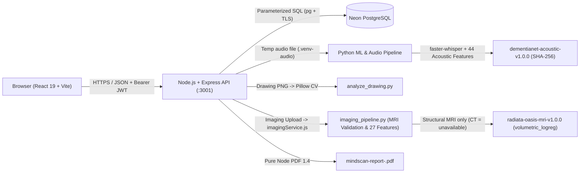
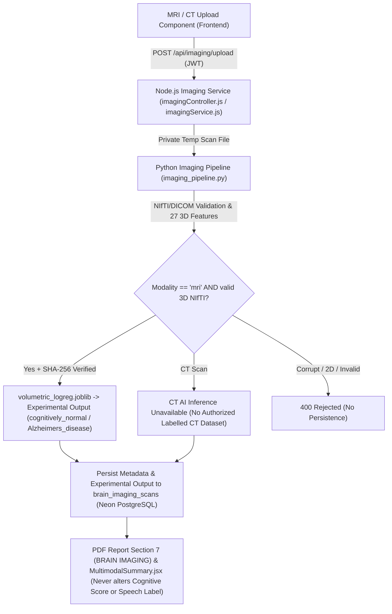
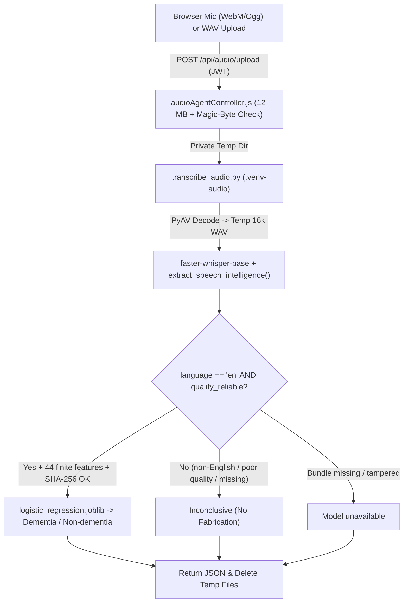
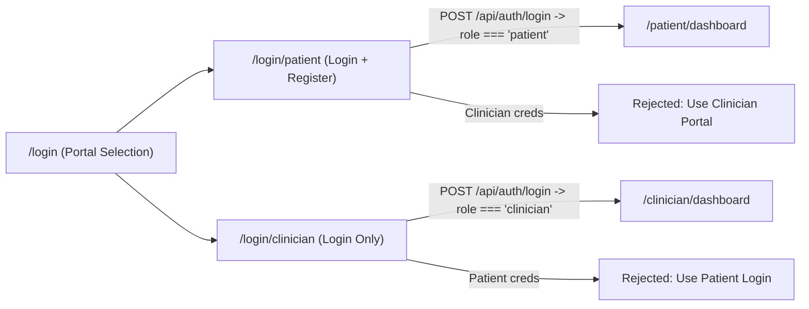

# MindScan AI — Early-Stage Dementia Screening & Research Prototype

MindScan AI is a full-stack, research-oriented cognitive, speech, physical-observation, and experimental neuroimaging screening prototype. It combines browser-based cognitive tasks, consent-driven audio recording/upload with offline `faster-whisper` transcription, 44-feature acoustic extraction, an experimental speaker-disjoint DementiaNet speech classifier (`dementianet-acoustic-v1.0.0`), an optional attendant-administered physical examination record, optional structural Brain MRI experimental analysis (`radiata-oasis-mri-v1.0.0`, `volumetric_logreg`), separate Patient and Clinician portals, PostgreSQL persistence, and downloadable PDF reports. Brain CT AI inference remains explicitly unavailable because no authorized labelled brain CT dementia dataset is available.

> **Important Non-Diagnostic Disclaimer:** This project is an academic and research prototype. **It is NOT a medical device, diagnostic tool, or validated clinical screening instrument.** Displayed scores, speech-based predictions, and experimental MRI research labels are not clinically validated, use uncalibrated relative scores rather than diagnostic probabilities, and must not be used to diagnose or exclude dementia. Clinical evaluation by a qualified healthcare professional is required.

---

## Table of Contents

1. [Project Introduction](#1-project-introduction)
2. [Features](#2-features)
3. [Technology Stack](#3-technology-stack)
4. [System Architecture](#4-system-architecture)
5. [Installation and Setup (Windows)](#5-installation-and-setup-windows)
6. [Project Folder Structure](#6-project-folder-structure)
7. [Database Schema & Migrations](#7-database-schema--migrations)
8. [Authentication and Security](#8-authentication-and-security)
9. [Machine Learning and Audio Processing](#9-machine-learning-and-audio-processing)
10. [Experimental MRI Dataset, Model & Age Confounding (Stages 14–14.2)](#10-experimental-mri-dataset-model--age-confounding-stages-14142)
11. [Scoring and Results](#11-scoring-and-results)
12. [Testing and Verification](#12-testing-and-verification)
13. [Limitations and Future Scope](#13-limitations-and-future-scope)
14. [License, Dataset Restrictions & Acknowledgements](#14-license-dataset-restrictions--acknowledgements)

---

## 1. Project Introduction

- **Project Name:** MindScan AI (Dementia Detection Tool)
- **Problem Statement:** Early cognitive and communication screening often relies on fragmented paper questionnaires that do not capture speech timing/acoustic measurements, drawing geometry, or longitudinal task history in a structured, privacy-preserving workflow. At the same time, naive prototypes often conflate descriptive task scores with ML model predictions or clinical diagnoses.
- **Motivation:** Build a transparent, modular full-stack platform that separates:
  1. deterministic cognitive task performance (**Assessment Performance Score /100**),
  2. **Assessment Completeness (%)** (excluding skipped/missing tasks rather than zero-imputing them),
  3. experimental speech classification (**DementiaNet PoC**) with strict quality/language gating,
  4. optional clinician/attendant physical observations and review notes, and
  5. optional experimental structural Brain MRI analysis (`radiata-oasis-mri-v1.0.0`, isolated from cognitive scoring and speech classification, while keeping Brain CT AI inference explicitly unavailable).
- **Objectives:**
  - Provide separate, role-verified **Patient** and **Clinician** portals.
  - Capture 10 structured screening tasks plus an optional attendant-administered physical examination and optional brain MRI/CT imaging upload.
  - Extract 44 acoustic/prosodic features and run SHA-256-verified experimental speech inference without persisting raw audio or raw transcripts.
  - Validate 3D NIfTI/DICOM brain imaging uploads, run experimental volumetric MRI inference (`volumetric_logreg`) when an authorized MRI bundle is present, and mark CT AI inference unavailable.
  - Persist results safely in PostgreSQL (Neon) and export consistent multi-page PDF reports.
- **Intended Users:**
  - **Patients:** Register/login, complete cognitive & voice assessments, view personal history, and download PDF reports.
  - **Clinicians (Administrator-Provisioned):** Review assigned patient screenings, inspect physical examination observations, add review notes, and download assigned patient PDF reports.

---

## 2. Features

### Authentication & Role-Separated Portals (Stage 12)
- **Role-Selection Entry (`/login`):** Separate **Patient Portal** and **Clinician Portal** cards.
- **Patient Login & Registration (`/login/patient`):** Patient-only public registration (`POST /api/auth/register`) and login (`POST /api/auth/login`) with password visibility toggle and language preference (`en`, `si`, `ta`).
- **Clinician Login (`/login/clinician`):** Login-only portal; public clinician registration is disabled (`403` on escalation; provisioned via CLI `Backend/scripts/create-clinician.js`).
- **Strict Role Enforcement:** Bidirectional portal-mismatch rejection (`validatePortalLoginRole`), signed JWT role/expiration checks, and direct-URL cross-role route guards (`/patient/dashboard` vs `/clinician/dashboard`).

### Cognitive, Drawing, Speech & Physical Examination Modules
- **Patient Intake:** Age and explicit consent required (`screening_patient_profiles`), optional demographics/history.
- **Immediate Memory (`memory`):** Timed 5-word memorization and free recall.
- **Delayed Memory (`delayed_memory`):** Delayed recall of the 5-word list, tracking intrusions and skips.
- **Attention (`attention`):** 10-round target/distractor reaction-time task.
- **Digit Span (`digit_span`):** Forward and backward digit sequence trials with per-trial skip.
- **Picture Recognition (`picture_recognition`):** Timed visual card memorization and recognition (true/false positives).
- **Pattern Recognition (`pattern_recognition`):** 4 sequence/pattern reasoning questions.
- **Orientation (`orientation`):** Year, month, date (validated against local assessment date), and location.
- **Language (`language`):** Sentence recall and animal naming fluency (kept as unscored descriptive observations).
- **Clock Drawing (`clock_drawing`):** HTML5 canvas drawing analyzed by Python `Pillow` (`Backend/ml/analyze_drawing.py`) for circularity, quadrant balance, and completeness (or optional skip).
- **Voice & Speech Assessment (`voice`):** Live browser microphone recording (`MediaRecorder`) or WAV/audio file upload (`POST /api/audio/upload`), offline `faster-whisper-base` transcription, 44-feature acoustic extraction, quality reliability gating, and experimental DementiaNet classification (`dementianet-acoustic-v1.0.0`).
- **Optional Physical Examination (`physical_examination`):** Attendant- or clinician-administered in-person **Sensory Response** (body region, method, response, notes) and **Reflex** (site, Left/Right/Both side, response, notes) observations, or optional skip. Never alters cognitive scores or speech predictions.
- **Optional Brain Imaging Upload & Experimental MRI Analysis:** Validates `.nii`, `.nii.gz`, `.dcm`, `.zip` uploads (`brain_imaging_scans`) and runs SHA-256-verified experimental structural T1-weighted MRI inference (`radiata-oasis-mri-v1.0.0`, `volumetric_logreg`) returning an experimental research label and uncalibrated relative scores. Brain CT AI inference remains explicitly `unavailable` because no authorized labelled brain CT dementia dataset is available.

### Dashboards, History, Reviews & Reporting
- **Unified Assessment Report (`MultimodalSummary.jsx`):** Displays Assessment Performance Score (`XX/100`), Assessment Completeness (`%`), Experimental Speech Model Prediction (`Dementia` / `Non-dementia` / `Inconclusive` / `Model unavailable`), uncalibrated decimal scores, threshold notice, individual tasks, recommendations, and non-diagnostic disclaimers.
- **Patient Dashboard (`PatientDashboard.jsx`):** Active screening resume, longitudinal Assessment History, inline `View Summary`, Notifications, and PDF download (`GET /api/screening/:id/report.pdf`).
- **Clinician Dashboard (`ClinicianDashboard.jsx`):** Assigned-patient-only screening list, search & status filters (`all`, `recent`, `incomplete`, `pending_review`), immutable patient response view, clinician review submission (`POST /api/clinician/screenings/:id/review`), and assigned PDF download.

---

## 3. Technology Stack

| Layer | Technologies Used | Purpose in Project |
|---|---|---|
| **Frontend** | React `19.2.8`, Vite `8.3.0`, History API (`authRouting.js`), Fetch / XHR | Role-based portals, interactive cognitive/drawing/voice UI, progress tracking, dashboards |
| **Backend** | Node.js, Express `4.22.3`, ESM modules | REST APIs, validation, scoring aggregation, subprocess orchestration, pure Node PDF 1.4 builder |
| **Database** | PostgreSQL (`pg` `8.23.0`), Neon PostgreSQL (TLS) | Persistent users, sessions, task responses (`JSONB`), results, reviews, assignments, notifications |
| **Authentication & Security** | `bcrypt` `6.0.0`, `jsonwebtoken` `9.0.3`, `cors` `2.8.6`, custom `securityMiddleware.js` | Password hashing, 1-day signed JWTs, RBAC, rate limiting, security headers |
| **Python Audio & ML** | Python `3.14` (`.venv-audio`), `faster-whisper` `1.2.1`, `av` `19.0.2`, `scipy` `1.18.1`, `numpy` `2.5.5`, `scikit-learn` `1.9.1`, `joblib` `1.6.0`, `pillow` `13.0.0` | Audio decoding, offline transcription, 44 acoustic features, clock-drawing CV analysis, DementiaNet PoC inference |
| **Deployment / Tooling** | `Dockerfile`s, `docker-compose.yml`, `dotenv` `17.4.2`, Node built-in test runner, Python `unittest` | Container definitions, env management, automated Backend/Frontend/Python test suites |

---

## 4. System Architecture

### High-Level Architecture



### Experimental Brain MRI Upload & Inference Flow (Isolated from Cognitive Scoring & Speech)



### Audio & Experimental Speech Classification Flow



### Authentication & Role Routing Flow



---

## 5. Installation and Setup (Windows)

### Prerequisites
- Node.js `v20+` (verified `v24.21.0`) and `npm`
- Python `3.11+` (verified `3.14`)
- PostgreSQL (Neon PostgreSQL with TLS, or local PostgreSQL `15+`)

### 1. Backend Setup
```powershell
cd D:\Dementia_Detection_Tool-main\Dementia_Detection_Tool-main\Backend
npm install
```
Copy `Backend/.env.example` to `Backend/.env` and set placeholders (never commit `Backend/.env`):
```env
NODE_ENV=development
PORT=3001
DATABASE_URL=postgresql://<user>:<password>@<host>/<db>?sslmode=require
DATABASE_SSL_REJECT_UNAUTHORIZED=true
JWT_SECRET=<strong-random-secret>
MINDSCAN_DEMO_MODE=false
PYTHON_EXECUTABLE=D:\Dementia_Detection_Tool-main\Dementia_Detection_Tool-main\.venv-audio\Scripts\python.exe
```

### 2. Database Connection & Migrations
```powershell
npm --prefix D:\Dementia_Detection_Tool-main\Dementia_Detection_Tool-main\Backend run database:test
npm --prefix D:\Dementia_Detection_Tool-main\Dementia_Detection_Tool-main\Backend run migrate
```

### 3. Provision a Clinician Account (CLI Only)
```powershell
node D:\Dementia_Detection_Tool-main\Dementia_Detection_Tool-main\Backend\scripts\create-clinician.js "Dr. Name" "clinician@example.com" "<min-8-char-password>"
```

### 4. Python `.venv-audio` Setup
```powershell
python -m venv D:\Dementia_Detection_Tool-main\Dementia_Detection_Tool-main\.venv-audio
D:\Dementia_Detection_Tool-main\Dementia_Detection_Tool-main\.venv-audio\Scripts\python.exe -m pip install -r D:\Dementia_Detection_Tool-main\Dementia_Detection_Tool-main\Backend\ml\requirements-audio.txt
D:\Dementia_Detection_Tool-main\Dementia_Detection_Tool-main\.venv-audio\Scripts\python.exe -m pip install scikit-learn joblib pillow
```
- Trained speech PoC bundle expected at `artifacts/models/speech_poc/dementianet-acoustic-v1.0.0/`.
- `faster-whisper-base` (`~145 MB`) downloads automatically on first transcription.

### 5. Frontend Setup & Running the App
```powershell
cd D:\Dementia_Detection_Tool-main\Dementia_Detection_Tool-main\Frontend
npm install
```
Set `Frontend/.env`:
```env
VITE_API_URL=http://localhost:3001
```
Start Backend and Frontend in separate terminals:
```powershell
npm --prefix D:\Dementia_Detection_Tool-main\Dementia_Detection_Tool-main\Backend start
npm --prefix D:\Dementia_Detection_Tool-main\Dementia_Detection_Tool-main\Frontend run dev -- --port 5173
```

---

## 6. Project Folder Structure

| Path | Responsibility |
|---|---|
| `Backend/server.js` | Express app setup, CORS, rate limiters, security headers, route mounting, health check |
| `Backend/routes/` | Express route definitions (`auth`, `screening`, `audio`, `drawing`, `riskAssessment`, `clinician`, `patient`, `result`, `notification`, `imaging`, `ml`, `ai`) |
| `Backend/controller/` | Request parsing, status codes, temp-file audio upload handling (`audioAgentController.js`) |
| `Backend/services/` | Business logic: `authService.js`, `screeningService.js`, `assessmentValidation.js`, `riskAssessmentService.js`, `recommendationService.js`, `clinicianService.js`, `pdfReportService.js` |
| `Backend/middleware/` | `authMiddleware.js` (JWT verification), `requireRole.js`, `securityMiddleware.js` |
| `Backend/database/migrations/` | Numbered SQL migrations `000_core_tables.sql` through `006_brain_imaging_scans.sql` |
| `Backend/ml/` | Python audio/ML inference (`transcribe_audio.py`, `audio_classifier.py`, `analyze_drawing.py`, `preprocessing/`, `training/dementianet_pipeline.py`) |
| `Frontend/src/` | React SPA (`App.jsx`, `authRouting.js`, `assessmentUtils.js`, `components/AuthPortal.jsx`, `PatientDashboard.jsx`, `ClinicianDashboard.jsx`, `VoiceTask.jsx`, `OptionalPhysicalExamTask.jsx`, `MultimodalSummary.jsx`, cognitive task components) |
| `artifacts/models/speech_poc/` | Versioned DementiaNet speech PoC bundle (`dementianet-acoustic-v1.0.0/`) with SHA-256 checksums |

---

## 7. Database Schema & Migrations

| Table (Migration) | Key Columns | Relationships |
|---|---|---|
| `users` (`000`, `004`) | `id` (PK), `name`, `email` (UNIQUE), `password_hash`, `role` (`patient`/`clinician`), `preferred_language` | Referenced by `screening_sessions`, `notifications`, `clinician_reviews`, `clinician_patient_assignments`, `brain_imaging_scans` |
| `screening_sessions` (`000`) | `id` (PK), `user_id` (FK -> `users`), `status`, `started_at`, `completed_at` | Parent of `screening_patient_profiles`, `task_responses`, `screening_results`, `clinician_reviews`, `brain_imaging_scans` |
| `screening_patient_profiles` (`001`) | `screening_id` (PK/FK), `patient_identifier`, `age` (1–120), `sex`, `education_years`, `handedness`, `consent_at` | 1:1 with `screening_sessions` |
| `task_responses` (`000`, `003`) | `id` (PK), `screening_id` (FK), `task_type`, `response_data` (`JSONB`), `score`, `reaction_time` | Indexed on `(screening_id, task_type, created_at DESC, id DESC)` |
| `screening_results` (`000`, `002`) | `id` (PK), `screening_id` (UNIQUE FK), `memory_score`, `attention_score`, `language_score`, `orientation_score`, `overall_score`, `task_scores` (`JSONB` storing `__multimodalSummary`), `recommendation`, `flags` | 1:1 with `screening_sessions` |
| `notifications` (`004`) | `id` (PK), `user_id` (FK), `title`, `message`, `type`, `is_read` | Indexed on `(user_id, is_read, created_at DESC)` |
| `clinician_reviews` (`004`, `005`) | `id` (PK), `screening_id` (FK), `clinician_id` (FK), `patient_id` (FK), `notes`, `review_status` (`pending`/`in_review`/`reviewed`), `follow_up_recommended` | Immutable clinician notes separate from patient responses |
| `clinician_patient_assignments` (`005`) | `id` (PK), `clinician_id` (FK), `patient_id` (FK), `UNIQUE(clinician_id, patient_id)` | Gates all clinician screening & PDF access |
| `brain_imaging_scans` (`006`) | `id` (PK), `screening_id` (FK), `user_id` (FK), `modality` (`mri`/`ct`), `original_format`, `storage_key`, `file_sha256`, `deidentified_metadata` | Metadata & quality-check storage |

---

## 8. Authentication and Security

- **Password Hashing:** `bcrypt` with cost factor `12`.
- **JWTs:** Signed with `JWT_SECRET` (`expiresIn: "1d"`), containing `{ userId, role }`. `authMiddleware` verifies signature and expiration on all protected routes.
- **Role-Based Access Control (`requireRole`):** Clinician endpoints (`/api/clinician/*`) require `role === "clinician"`; public `/api/auth/register` rejects non-patient roles with `403`.
- **Assignment Isolation (`isClinicianAuthorizedForScreening`):** Clinicians can only read/review/download PDFs for patients explicitly assigned in `clinician_patient_assignments` (unassigned screenings return `403`).
- **Hardening (`server.js`, `securityMiddleware.js`):** Rate limiting on `/api/auth` (`60` req / `15m`) and `/api/audio` (`20` req / `1m`), `X-Powered-By` disabled, security headers, strict CORS in production, input validation (`assessmentValidation.js`), no raw transcript persistence, and `.gitignore` exclusions for `.env`, raw audio, and model binaries.

---

## 9. Machine Learning and Audio Processing

- **Dataset:** **DementiaNet** (`github.com/shreyasgite/dementianet`) — public-figure English YouTube interview WAV clips with **weak biographical labels** (`nodementia` vs `dementia`), **not** clinical MMSE/MoCA/CDR diagnoses.
- **Post-Download Audio Audit (`research-data/dementianet/raw/`, gitignored):** `454` WAVs downloaded -> `453` valid (`>= 0.5s`, `44100 Hz`), `1` corrupt/silent skipped, `0` duplicates, **`214` unique speakers** (`nodementia: 324`, `dementia: 129`).
- **44 Acoustic/Prosodic Features (`ACOUSTIC_FEATURE_COLS`):**
  - Voicing & Energy (4): `voiced_frame_ratio`, `voiced_unvoiced_ratio`, `energy_rms_mean`, `energy_rms_std`
  - Spectral & ZCR (4): `zcr_mean`, `spectral_centroid_hz`, `spectral_bandwidth_hz`, `spectral_rolloff_hz`
  - Pitch & Perturbation (7): `pitch_mean_hz`, `pitch_median_hz`, `pitch_std_hz`, `pitch_range_hz`, `jitter_local`, `shimmer_local`, `hnr_mean_db`
  - Waveform Silence/Pause (3): `waveform_silence_ratio`, `waveform_pause_count`, `waveform_mean_pause_seconds`
  - MFCCs (26): `mfcc_1_mean`..`mfcc_13_mean`, `mfcc_1_std`..`mfcc_13_std`
- **Speaker-Disjoint Split (`participant_level_split`):** Train `271` (`128` speakers), Validation `91` (`43` speakers), Test `91` (`43` speakers) — zero speaker overlap.
- **Independent Test Set Results (`n = 91` recordings, `43` speakers):**

| Model | Accuracy (95% Wilson CI) | Precision | Recall | Specificity | F1 | ROC-AUC | PR-AUC |
|---|---|---|---|---|---|---|---|
| **`logistic_regression` (Selected)** | **0.7363** `[0.6375, 0.8159]` | **0.5333** | **0.6154** | **0.7846** | **0.5714** | **0.7562** | **0.5257** |
| `svm_rbf` | 0.7143 `[0.6143, 0.7969]` | 0.5000 | 0.4615 | 0.8154 | 0.4800 | 0.6763 | 0.4444 |
| `gradient_boosting` | 0.6923 `[0.5913, 0.7777]` | 0.4375 | 0.2692 | 0.8615 | 0.3333 | 0.6568 | 0.4085 |
| `random_forest` | 0.6593 `[0.5573, 0.7485]` | 0.3913 | 0.3462 | 0.7846 | 0.3673 | 0.6757 | 0.4105 |
| `silence_control` (baseline) | 0.5824 `[0.4798, 0.6784]` | 0.3000 | 0.3462 | 0.6769 | 0.3214 | 0.5101 | 0.3719 |

- **Runtime Gating (`classify_acoustic_poc`):**
  - Verifies `metadata.json` and `.joblib` SHA-256 checksum (`Model unavailable` if missing/tampered).
  - Requires `language == "en"`, `quality_reliable === true`, and all 44 finite features (`Inconclusive` otherwise; never fabricates missing features).
  - Uses default `0.50` validation cutoff (`dementianet-val-default-0.50/v1.0`), labeled *"Experimental classification — threshold not clinically validated"*.

---

## 10. Experimental MRI Dataset, Model & Age Confounding (Stages 14–14.2)

### Dataset & Participant-Disjoint Split
- **Dataset:** `radiata-ai/brain-structure` (`OASIS-1` and `OASIS-2` T1-weighted structural brain MRI subset, skull-stripped and MNI152-aligned at `113×137×113`, `1.5 mm³` isotropic resolution).
- **Cohort Counts:** **`787` 3D T1-weighted MRI scans** across **`564` unique participants** (`0` corrupt scans, `0` duplicate SHA-256 hashes):
  - **`cognitively_normal`:** `522` scans (`400` subjects)
  - **`Alzheimers_disease`:** `265` scans (`178` subjects)
  - *(Does **not** cover MCI or non-AD dementias.)*
- **Participant-Disjoint Split (`participant_level_split`, seed `42`):** Train `472` scans (`339` participants), Validation `157` scans (`113` participants), Untouched Test `158` scans (`112` participants) — zero participant overlap across splits (`OASIS-2` longitudinal visits stay grouped).
- **Preprocessing Isolation:** `SimpleImputer` and `StandardScaler` are fit strictly on the training split; test-set statistics are never used.

### Architectures Evaluated & Selected Model
Three candidate architectures were trained and evaluated (`Backend/ml/training/radiata_mri_pipeline.py`):
1. **`volumetric_logreg` (Selected Live Default):** `SimpleImputer` + `StandardScaler` + `LogisticRegression(class_weight="balanced")` on 27 3D morphometric and regional intensity features.
2. **`triplanar_2d_cnn`:** PyTorch `Conv2d` on 3-channel (`64×64` axial/coronal/sagittal mid-slices) with `BCEWithLogitsLoss(pos_weight=...)`.
3. **`lightweight_3d_cnn`:** PyTorch `Conv3d` on `32×40×32` trilinearly downsampled MRI volumes with `BCEWithLogitsLoss(pos_weight=...)`.

**Untouched Original Test Set Results (`n = 158` scans, `112` participants):**

| Model | Val ROC-AUC | Accuracy (95% CI) | Precision | Recall | Specificity | F1 | ROC-AUC | PR-AUC |
|---|---:|---:|---:|---:|---:|---:|---:|---:|
| **`volumetric_logreg` (Selected)** | `0.7910` | **79.11%** `[0.7212, 0.8472]` | **66.15%** | **79.63%** | **78.85%** | **72.27%** | **0.8770** | **0.7404** |
| `triplanar_2d_cnn` | `0.8385` | `60.76%` `[0.5298, 0.6803]` | `46.49%` | `98.15%` | `41.35%` | `63.10%` | `0.8312` | `0.6904` |
| `lightweight_3d_cnn` | `0.7979` | `34.18%` `[0.2724, 0.4187]` | `34.18%` | `100.00%` | `0.00%` | `50.94%` | `0.7981` | `0.6436` |

- **Bundle & Isolation:** Stored at `artifacts/models/imaging/radiata-oasis-mri-v1.0.0/` (gitignored) with SHA-256 verification. MRI inference is **completely isolated** from the cognitive Assessment Performance Score and the DementiaNet speech classifier.
- **CT AI Inference:** Explicitly **unavailable** because no authorized labelled brain CT dementia dataset is available.

### Age Confounding Investigation (Stage 14.2)
Stage 14.1 revealed a major age imbalance across the `787` scans (`0` missing age or sex; all `787` scans acquired on Siemens `Vision` `1.5T` scanners, so scanner/field strength is not confounded within this subset):
- **Cognitively normal mean age:** `57.98` years (`± 24.77`, range `18–97`, includes young `18–59` adults in OASIS-1)
- **Alzheimer's disease mean age:** `76.77` years (`± 7.09`, range `61–98`)
- **Mean age difference:** approximately **`18.8` years**

| Evaluation Setup | Test n (pos) | Accuracy (95% CI) | ROC-AUC | PR-AUC |
|---|---:|---:|---:|---:|
| **Original MRI (`volumetric_logreg`, full test)** | `158` (`54`) | `79.11%` `[0.7212, 0.8472]` | `0.8770` | `0.7404` |
| **Age-Only Baseline (full test)** | `158` (`54`) | `62.66%` `[0.5490, 0.6982]` | `0.6868` | `0.4506` |
| **Age-Restricted MRI (`test[age >= 60]`)** | `112` (`54`) | `70.54%` `[0.6152, 0.7818]` | `0.7842` | `0.7420` |
| **Age-Restricted Age-Only (`test[age >= 60]`)** | `112` (`54`) | `47.32%` `[0.3832, 0.5650]` | `0.4384` | `0.4506` |
| **Fresh Age-Matched MRI (`age >= 60` cohort)** | `115` (`53`) | `71.30%` `[0.6245, 0.7878]` | `0.7754` | `0.7780` |
| **Fresh Age-Matched Age-Only (`age >= 60` cohort)** | `115` (`53`) | `47.83%` `[0.3891, 0.5688]` | `0.4819` | `0.4560` |

> **Scientific Caution:** Because `Age-Only` alone achieves `0.6868` ROC-AUC on the full cohort (and drops to chance `0.4384–0.4819` when `18–59` controls are excluded), the original headline ROC-AUC of `0.8770` is inflated by `~0.09–0.10` due to age imbalance and **must not be interpreted as independent clinical Alzheimer's detection performance**. While the MRI model retains structural signal above age (`0.7754–0.7842` ROC-AUC at `age >= 60`), it remains strictly an experimental proof-of-concept.

---

## 11. Scoring and Results

- **Assessment Performance Score (`assessment-performance/1.0.0`):**
  $$\text{Assessment Performance Score} = \frac{1}{|M|} \sum_{t \in M} s_t$$
  where $M$ is the subset of completed, non-skipped numeric tasks from `memory`, `delayed_memory`, `digit_span`, `picture_recognition`, `pattern_recognition`, `orientation`, and `attention`.
- **Excluded Tasks:** Skipped and missing tasks are excluded (never scored as `0`); `language` (unscored), `clock_drawing` (spatial CV heuristics), `voice` (speech timing/classifier), and `physical_examination` (observational only) are kept separate.
- **Assessment Completeness:** `completedCount / 10 * 100%`, reported separately.
- **Experimental Speech Scores:** `scores_are_calibrated_probabilities` is `false` — scores are relative uncalibrated classifier outputs, never clinical dementia probabilities.

---

## 12. Testing and Verification

Latest verified results (Stages 14–14.2):

| Suite | Command / Scope | Result |
|---|---|---|
| **Backend Node Tests** | `npm --prefix Backend test` | **`75/75` passed** (`0` failures) |
| **Frontend Unit Tests** | `npm --prefix Frontend test` | **`16/16` passed** (`0` failures) |
| **Frontend Production Build** | `npm --prefix Frontend run build` | **Passed** (`32` modules transformed in `280ms`, `0` errors) |
| **`.venv-audio` Audio & MRI PoC Tests** | `test_audio_validation`, `test_transcribe_audio`, `test_dementianet_poc`, `test_radiata_mri_poc` | **`17/17` passed** (`0` failures) |
| **Full Python ML Suite** | `python -m unittest discover -s Backend\ml -p "test_*.py"` | **`79` run: `74` passed, `5` skipped, `0` failures** |
| **Live Browser E2E (Stages 10.7–14.1)** | Chromium against `localhost:5173` -> `localhost:3001` | Patient, Clinician, Physical Exam, Stage 12 role-login/routing, live **MRI upload (`201`) + Neon persistence**, **corrupt MRI rejection (`400`)**, and **CT inference unavailable (`201`)** verified (`0` console errors) |

> **PDF Verification Note:** While full Screening PDF downloads were verified in Stages 10.7–11, **Screening `#18` PDF download** (used for Stage 14.1 imaging upload testing) was **not** completed (`GET /api/screening/18/report.pdf` returned `HTTP 404`: `"Complete these required tasks first: memory, attention, orientation, language"`) because Screening `#18` had only imaging uploaded without the required cognitive tasks. Full PDF E2E verification is therefore not claimed for Screening `#18`.

---

## 13. Limitations and Future Scope

- **Research Proof-of-Concept Only / No External Clinical Validation:** Neither the cognitive Assessment Performance Score, the `0.50` DementiaNet speech cutoff, nor the experimental MRI model is clinically validated against external multi-site clinical cohorts or gold-standard diagnoses (MMSE/MoCA/CDR).
- **MRI Age-Related Confounding & Demographic Imbalance:** In the `radiata-ai/brain-structure` OASIS-1+2 subset, cognitively normal controls are on average `~18.8` years younger (`57.98` vs `76.77` years) and include `18–59` adults, inflating full-cohort ROC-AUC (`0.8770`) relative to age-matched `age >= 60` performance (`0.7754–0.7842`). All scans are also single-scanner (`Siemens Vision 1.5T`) skull-stripped MNI152 volumes (`113×137×113`).
- **Experimental MRI Output & Uncalibrated Scores:** MRI inference returns an **experimental research label** (`cognitively_normal` or `Alzheimers_disease` only — no MCI or non-AD dementias), **not a clinical diagnosis**, and its scores are **uncalibrated relative scores** (`scores_are_calibrated_probabilities: false`), **not diagnostic probabilities**.
- **No Brain CT AI Inference:** No authorized labelled brain CT dementia dataset is available; Brain CT uploads store validated metadata only with AI inference explicitly `unavailable`.
- **Experimental Speech Model:** DementiaNet uses public-figure English YouTube interviews with weak biographical labels, class imbalance (`324` vs `129`), and English-only coverage (`hi`/`pa`/`si`/`ta` gated as `Inconclusive`).
- **Minor UI Polish:** Minor horizontal overflow on `375×812` mobile viewports; SPA production hosting requires rewrite rules to `index.html`.
- **Future Scope:** Acquire DUA-governed multi-site clinical corpora (ADReSSo, DementiaBank Pitt, ADNI, clinical CT cohorts), train age-matched and multilingual models, calibrate probabilities, and run prospective clinical validation.

---

## 14. License, Dataset Restrictions & Acknowledgements

- **Project License:** `ISC` (as declared in `Backend/package.json`; no root `LICENSE` file is present).
- **OASIS & MRI Dataset Licensing Restrictions:**
  - `radiata-ai/brain-structure` (`ODC-By v1.0` compilation) contains preprocessed `OASIS-1` and `OASIS-2` T1-weighted MRI volumes (`https://sites.wustl.edu/oasisbrains/`).
  - **OASIS Data Use Agreement (DUA) obligations remain applicable:** Anonymization or skull-stripping does **not** automatically remove redistribution restrictions or DUA obligations. Facial reconstruction and re-identification are strictly prohibited.
  - **Gitignored Local Assets:** Both raw `.nii.gz` scans (`research-data/radiata_mri/`) and trained model weights (`artifacts/models/imaging/radiata-oasis-mri-v1.0.0/`, `artifacts/models/speech_poc/`) remain gitignored and **must not be publicly redistributed** without appropriate permission and compliance with source terms.
  - Always provide attribution (`OASIS-1`, `OASIS-2`, `radiata-ai/brain-structure`) and follow all applicable dataset terms.
- **Other Third-Party Datasets & Dependencies:**
  - **DementiaNet:** MIT-licensed repository metadata; third-party YouTube audio clips used locally for non-commercial research only (excluded via `.gitignore`).
  - **Zenodo Open Datasets (`13378346`, `5509808`):** `CC-BY-4.0`.
  - **Libraries:** React, Express, PostgreSQL (`pg`), `faster-whisper`, PyAV, `scikit-learn`, `joblib`, `nibabel`, `Pillow`, `bcrypt`, `jsonwebtoken`.
